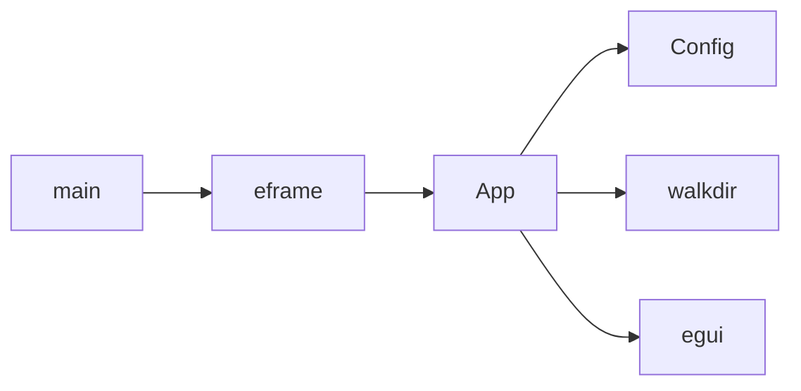
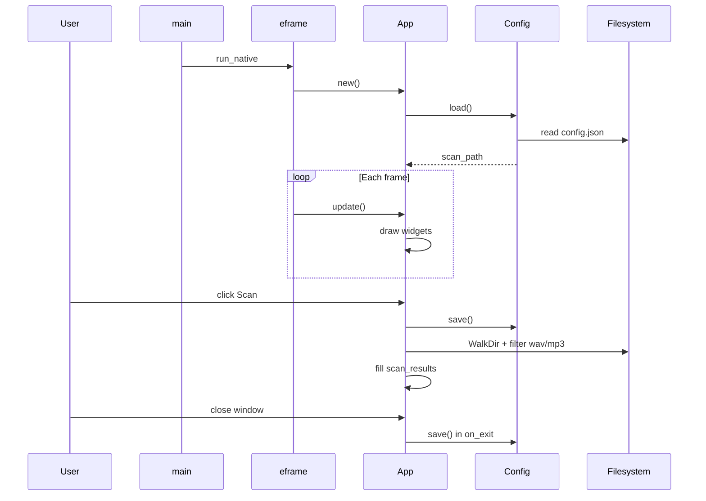

# Code explanation

In-depth walkthrough of `src/main.rs` for developers new to Rust. For install and usage, see [README.md](README.md).

## Overview

The program is a single **binary crate**: one file (`main.rs`) with three main pieces:

| Piece | Type | Responsibility |
|-------|------|----------------|
| `main` | function | Start the window and event loop |
| `Config` | struct + `impl` | Load/save folder path to JSON on disk |
| `App` | struct + `impl` + trait | UI state, scan logic, draw each frame |



---

## File structure

Everything lives in `src/main.rs` today. A larger project might split into:

- `config.rs` — `Config`
- `scan.rs` — directory walking
- `ui.rs` — `eframe::App` implementation

---

## Crate attribute (line 1)

```rust
#![cfg_attr(not(debug_assertions), windows_subsystem = "windows")]
```

- `#![...]` applies to the **whole crate** (not the next line).
- In **release** builds only, Windows links this as a GUI app so no extra console window appears behind the UI.
- **Debug** builds (`cargo run`) keep the console, which helps if something panics or prints errors.

---

## Imports

```rust
use directories::ProjectDirs;
use eframe::egui;
use serde::{Deserialize, Serialize};
use std::path::{Path, PathBuf};
```

`use` shortens names: `Path` instead of `std::path::Path`.

- `std` — standard library (paths, files, strings).
- Other crates come from `Cargo.toml` dependencies.

---

## Constants

```rust
const APP_QUALIFIER: &str = "com";
const APP_ORGANIZATION: &str = "vst-manager";
const APP_NAME: &str = "vst-manager";
```

These three strings are passed to `ProjectDirs::from(...)` so the OS picks a stable config folder (see [README.md](README.md#saved-settings)).

- `const` — compile-time constant.
- `&str` — borrowed string slice (UTF-8 text, not owned on the heap).

---

## `main` — entry point

```rust
fn main() -> eframe::Result<()> {
    let options = eframe::NativeOptions { ... };
    eframe::run_native("VST Manager", options, Box::new(|cc| Ok(Box::new(App::new(cc)))))
}
```

### Return type: `Result<()>`

- `Result<T, E>` is either `Ok(value)` or `Err(error)`.
- `()` is the **unit type** — “no meaningful return value” (like void, but a real type).
- If `run_native` fails, the error propagates out of `main` and the process exits with a failure code.

### `NativeOptions`

Sets initial window size (720×480) and title. `..Default::default()` fills remaining fields with defaults (from the `Default` trait).

### `run_native` and the closure

```rust
Box::new(|cc| Ok(Box::new(App::new(cc))))
```

| Part | Meaning |
|------|---------|
| `Box::new(...)` | Heap-allocated ownership; required because the framework stores the app behind a trait object |
| `\|cc\| ...` | Closure (small anonymous function) called once at startup |
| `cc` | `CreationContext` — fonts/GPU setup (unused here: `_cc` in `App::new`) |
| `Ok(Box::new(App::new(cc)))` | Build your `App` and wrap success in `Result` |

**eframe** owns the event loop: window events, input, and calling `App::update` every frame.

---

## `Config` — persisted settings

```rust
#[derive(Default, Serialize, Deserialize)]
struct Config {
    scan_path: String,
}
```

### `struct`

Groups related data. Here, one field: the last folder path as an owned `String`.

### `#[derive(...)]`

Macro that auto-generates trait implementations:

| Trait | Effect |
|-------|--------|
| `Default` | `Config::default()` → empty `scan_path` |
| `Serialize` | `Config` → JSON string |
| `Deserialize` | JSON string → `Config` |

### `Config::path() -> Option<PathBuf>`

```rust
ProjectDirs::from(APP_QUALIFIER, APP_ORGANIZATION, APP_NAME)
    .map(|dirs| dirs.config_dir().join("config.json"))
```

- Returns `Option<PathBuf>`: `Some(path)` or `None` if the OS path cannot be resolved.
- `.map(|dirs| ...)` — if `Some`, transform; if `None`, stay `None`.

### `Config::load() -> Self`

1. **`let Some(path) = Self::path() else { return Self::default(); }`**  
   Rust 1.65+ **let-else**: if not `Some`, return empty config early.

2. **`read_to_string(&path)`** → `Result<String, io::Error>`.  
   `&path` **borrows** the path for the call without taking ownership.

3. **`.ok()`** — turn `Result` into `Option` (errors become `None`).

4. **`.and_then(|s| serde_json::from_str(&s).ok())`** — if file read succeeded, try JSON parse; any failure → `None`.

5. **`.unwrap_or_default()`** — `Some(config)` or default empty `Config`.

`Self` inside `impl Config` means “this type” (`Config`).

### `Config::save(&self)`

- **`&self`** — shared borrow: read fields, do not consume `self`.
- Creates parent directories if needed.
- Writes pretty-printed JSON; errors are ignored (`let _ = ...`) for simplicity.

---

## `App` — application state

```rust
struct App {
    path_input: String,           // text in the folder field
    scan_results: Vec<PathBuf>,   // paths from last scan
    status: String,               // user-facing message line
}
```

| Type | Role |
|------|------|
| `String` | Owned, growable UTF-8 text |
| `Vec<PathBuf>` | Owned list of owned paths |
| `PathBuf` | Owned filesystem path (like `String` for paths) |
| `&Path` | Borrowed view of a path (often from `Path::new(...)`) |

### `App::new`

Loads `Config`, copies `scan_path` into `path_input`, starts with empty results and status.

The `scan_path` **moves** out of `config` into `path_input` (ownership transfer).

### `App::persist_path`

```rust
Config { scan_path: self.path_input.clone() }.save();
```

`clone()` duplicates the string because `self.path_input` is still needed after saving.

---

## `App::scan` — find audio files

Signature: **`fn scan(&mut self)`**

- **`&mut self`** — exclusive mutable borrow: may change all fields of `self` for the duration of the call.
- Rust rule: either many shared `&` readers **or** one `&mut` writer to the same data (not both at once). This prevents data races without a garbage collector.

### Steps

1. Save path, clear `scan_results`.
2. **`Path::new(self.path_input.trim())`** — borrow trimmed text as a path (no allocation).
3. Validate: non-empty, exists, is a directory. On failure, set `status` and **`return`** early.
4. **Loop** with `walkdir::WalkDir`:
   - Recurses into subfolders.
   - `filter_map(|e| e.ok())` skips entries that errored (permissions, etc.).
   - Skip non-files (`continue`).
   - **`let Some(ext) = ... else { continue }`** — skip files with no extension or non-UTF-8 extension.
   - **`matches!(ext.to_ascii_lowercase().as_str(), "wav" | "mp3")`** — case-insensitive extension check.
   - **`push(entry.path().to_path_buf())`** — store an owned copy of the path.
5. **`sort()`** on paths, then set `status` with count.

### Useful Rust in the loop

| Syntax | Meaning |
|--------|---------|
| `for x in iter` | Consume an iterator |
| `continue` | Skip to next iteration |
| `matches!(a, pat)` | Pattern match that returns `bool` |
| `.into()` | Convert type via `From` trait (e.g. `&str` → `String` for `status`) |

---

## `impl eframe::App for App` — UI each frame

A **trait** is a contract: “types that implement `eframe::App` must provide `update`.”

The framework calls **`update(&mut self, ...)`** every frame (~60 times per second). This is **immediate mode UI**: widgets are recreated each frame from current state; there is no separate widget tree stored in egui.

### Layout (top to bottom)

1. **Heading** and spacing.
2. **Horizontal row**: label + `TextEdit::singleline(&mut self.path_input)`.
   - Needs `&mut String` so egui can edit text in place.
   - `response.changed()` → call `persist_path()`.
3. **Buttons row**:
   - **Browse…** — `rfd::FileDialog::pick_folder()` opens a native dialog; on success, set `path_input` and save.
   - **Scan** — `self.scan()`.
4. **Status label** if `status` is non-empty.
5. **`ScrollArea`** — list each path in `scan_results`, or a placeholder message.

### `on_exit`

Called when the window closes; saves path one last time.

---

## Ownership and borrowing (core Rust)

You do not see pointers explicitly, but these rules apply everywhere:

1. Every value has **one owner** at a time.
2. When the owner goes out of scope, the value is **dropped** (memory freed, files closed).
3. **Borrowing** lets other code use a value temporarily:
   - `&T` — shared read-only borrow(s) allowed.
   - `&mut T` — one exclusive mutable borrow.

Examples in this file:

| Code | Borrow / move |
|------|----------------|
| `save(&self)` | Read config, don’t take ownership of `App` |
| `scan(&mut self)` | Mutate `scan_results`, `status` |
| `TextEdit::singleline(&mut self.path_input)` | UI mutates the string |
| `for file in &self.scan_results` | Borrow vec, don’t move it |
| `self.path_input.clone()` | Explicit copy when both old and new strings are needed |

**Move:** assigning a `String` or `Vec` to another variable often **moves** ownership; the old binding is no longer valid unless you `clone()`.

---

## `Option` and `Result`

### `Option<T>`

`Some(value)` or `None`. Used when a value might be missing (config path, folder picker result, file extension).

Common methods:

- `if let Some(x) = opt { ... }`
- `let Some(x) = opt else { return; }`
- `.map(|v| ...)`, `.and_then(|v| ...)`, `.unwrap_or_default()`

### `Result<T, E>`

`Ok(value)` or `Err(error)`. Used for I/O and JSON (`read_to_string`, `from_str`).

This project often converts `Result` → `Option` with `.ok()` and falls back to defaults instead of showing I/O errors in the UI.

---

## Execution timeline



---

## Rust concepts cheat sheet

| You see | Meaning |
|---------|---------|
| `let x = ...` | Immutable binding (default) |
| `let mut x = ...` | Mutable binding |
| `fn name(&self)` | Method with shared borrow |
| `fn name(&mut self)` | Method with exclusive borrow |
| `struct` | Custom data type |
| `impl Type { }` | Methods for `Type` |
| `impl Trait for Type` | “`Type` implements `Trait`” |
| `#[derive(...)]` | Auto-generate trait code |
| `Self` | Current type inside `impl` |
| `\|x\| expr` | Closure |
| `Box::new(t)` | Heap ownership |
| `_name` | Intentionally unused variable |
| `continue` / `return` | Loop skip / early exit |

---

## Suggested learning path

1. [Rust Book — Variables and ownership](https://doc.rust-lang.org/book/ch02-00-guessing-game-tutorial.html) (ch. 2–4)
2. [Rust Book — Structs and enums](https://doc.rust-lang.org/book/ch05-00-structs.html) (ch. 5–6)
3. [Rust Book — Error handling](https://doc.rust-lang.org/book/ch09-00-error-handling.html) (`Result`, `Option`, `?`)
4. [Rust Book — Traits](https://doc.rust-lang.org/book/ch10-02-traits.html) (ch. 10)
5. [egui docs](https://docs.rs/egui/latest/egui/) — immediate mode UI mental model

---

## Small experiments

Try these in `main.rs` to learn by changing behavior:

1. Show I/O errors in `status` instead of ignoring them in `Config::save`.
2. Add `flac` next to `wav` and `mp3` in the `matches!` line.
3. Log the number of skipped `WalkDir` errors (remove `.filter_map(|e| e.ok())` and handle `Result` explicitly).

---

## Related files

| File | Contents |
|------|----------|
| [README.md](README.md) | Install, run, config paths, dependencies |
| [Cargo.toml](Cargo.toml) | Package name and crate versions |
| [src/main.rs](src/main.rs) | Full source |
